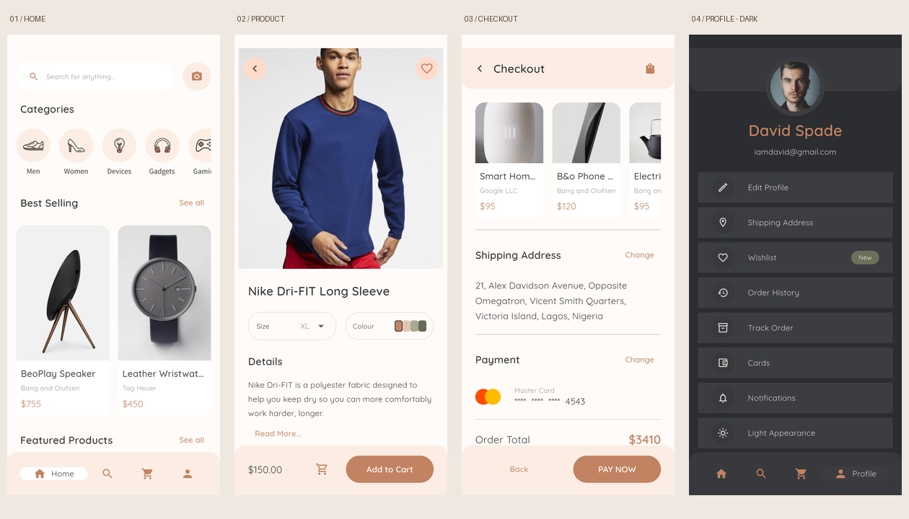
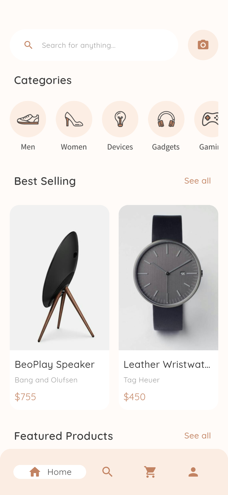
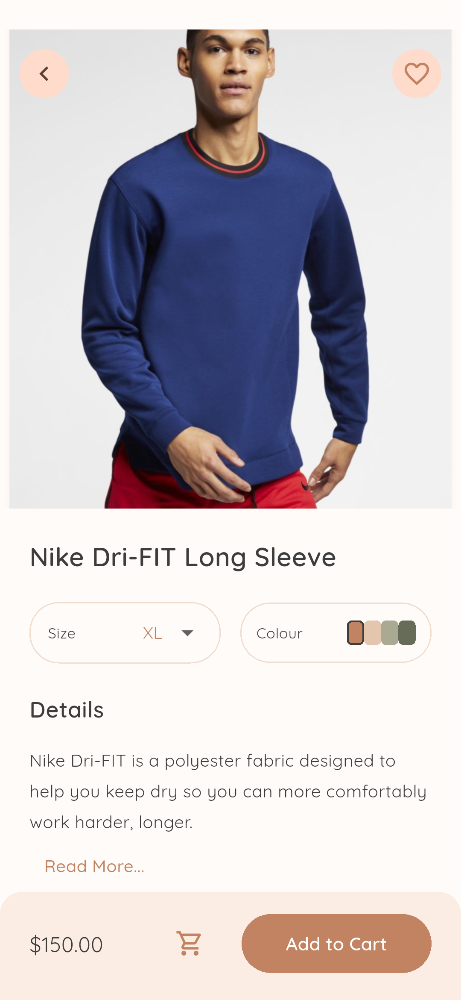
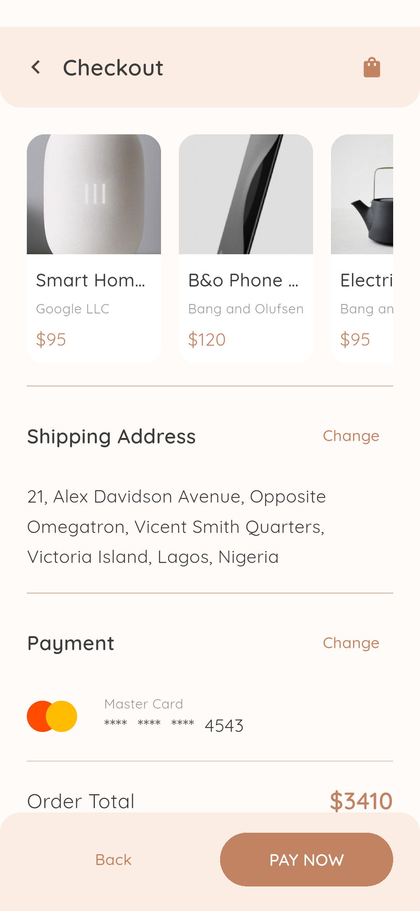
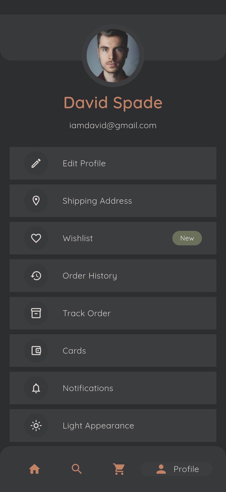

# E-COM · Flutter 电商 App

根据 Pixso 中 **Adobe XD E-COM** 的页面与素材实现，包含浅色、深色主题和完整的本地购物演示流程。



## 交付内容

- Flutter 源码：Android 与 iOS 工程、31 个页面/界面状态。
- 设计读取记录：86 个顶层画板，58 个手机画板（浅色与深色各 29 个），28 个展示排版；另检查了 Components 分类。
- App 截图：每个页面/状态均有浅色与深色截图，另含实际下单流程的成功结果。
- 本文包含项目结构、模块职责、运行方式、测试记录与演示边界。

原稿：[Pixso · Adobe XD E-COM](https://pixso.cn/app/design/Em65iD7WMxdJanxopo6qhA)。通过 Refore Pixso MCP（6300 端口）读取页面、节点、文字、颜色、字号和图片，仅进行读取与导出。

完整画板记录见 [设计清单](docs/reference/README.md)、[节点清单](docs/reference/manifest.json) 和 [文字记录](docs/reference/screen-texts.json)。`xd page` 为界面及展示稿；`Components` 只有状态栏组件，App 使用系统安全区与原生状态栏。

## 界面与操作

| 模块 | 已实现页面/状态 | 主要操作 |
|---|---|---|
| 账户入口 | Welcome、Sign Up、Verification | 表单校验、演示登录、六位验证码输入 |
| 商品浏览 | 首页、首页滚动状态、分类、品牌 | 分类入口、品牌入口、商品详情、页面滚动 |
| 筛选 | 筛选面板、展开价格/颜色状态 | 价格范围、选项切换、应用与清除 |
| 搜索 | 最近搜索、输入建议、图片搜索、图片结果/详情 | 本地商品名称及品牌搜索、演示识图跳转 |
| 商品详情 | 商品首屏、详情/评价状态 | 尺码、颜色、详情展开、收藏、加入购物车、评价输入 |
| 购物车 | 商品列表、金额与优惠码 | 增减数量、滑动删除、收藏、`WELCOME10` 九折优惠 |
| 结算 | 配送、地址、支付、订单摘要、下单成功 | 配送选择、日期选择、地址与卡片校验、演示下单 |
| 个人中心 | Profile、编辑资料、Wishlist | 修改姓名/邮箱、切换明暗主题、管理收藏 |
| 订单 | Orders、Track Order、Map | 查看历史示例订单、状态时间线、参考地图 |
| 地址与卡片 | Shipping Address、Cards、Add Card | 新增与选择地址、新增与选择卡片标签 |

所有界面的截图入口在 [截图索引](docs/screenshots/README.md)。原稿的滚动与弹层画板作为同一功能的状态复用，并未为明暗两套稿分别复制业务代码。新增的编辑资料、成功页补齐了演示流程。

## 主要界面

| 首页 | 商品详情 |
|---|---|
|  |  |

| 订单摘要 | 深色个人中心 |
|---|---|
|  |  |

## 项目结构

```text
AdobeXDE-COM/
├── lib/
│   ├── main.dart                    # 初始化 Flutter、本地存储
│   ├── app.dart                     # 页面切换、返回历史、底部导航
│   ├── core/
│   │   ├── app_theme.dart           # 浅色/深色主题与配色
│   │   └── routes.dart              # 页面枚举与导航接口
│   ├── data/
│   │   └── catalog.dart             # 商品、地址、卡片模型与演示目录
│   ├── state/
│   │   └── store_controller.dart    # 购物车、收藏、金额、资料与持久化
│   └── ui/
│       ├── widgets.dart             # 商品卡片、输入框、标题、底部操作条
│       ├── auth_screens.dart        # 登录、注册、验证码
│       ├── catalog_screens.dart     # 首页、分类、搜索、商品详情
│       ├── checkout_screens.dart    # 购物车、结算、成功页
│       └── account_screens.dart     # 个人中心、订单、地址、卡片
├── assets/
│   ├── fonts/                       # Quicksand 字体及 OFL 授权
│   └── images/                      # Pixso MCP 导出的原稿素材
├── android/                         # Android 工程
├── ios/                             # iOS 工程（本机未编译）
├── test/                            # 状态、校验、布局与购物流程测试
├── integration_test/app_test.dart   # Android 设备验证与截图采集
├── test_driver/screenshots.dart     # 保存设备截图
└── docs/
    ├── reference/                   # 原稿参考图、节点与文字清单
    ├── screenshots/                 # 实际运行截图及索引
    ├── TESTING.md                   # 测试环境、结果与复现方式
    └── test-results.txt             # 自动化测试输出
```

## 架构说明

采用 **页面 → StoreController → 数据/本地存储** 的轻量结构。

页面负责布局、表单输入和导航，金额、数量、收藏及保存行为集中在 `StoreController`。使用 Flutter 自带的 `ChangeNotifier` 与 `ListenableBuilder` 刷新内容，运行时额外依赖仅 `shared_preferences`，没有引入额外的状态管理或路由框架。

`catalog.dart` 中的模型不依赖 UI。共用元素集中在 `widgets.dart`，配色集中在 `app_theme.dart`，明暗主题共用页面与状态。较宽屏幕将内容宽度限制为 480，手机界面保持可滚动。

本地保存购物车、收藏、姓名/邮箱、地址、卡片标签、主题和已下单数量。卡片只保存持卡人标签、有效期与后四位；完整卡号和 CVV 不写入持久化数据。结算金额按单价与数量计算，避免沿用原稿中固定的示例合计。

接入后端时，可将商品目录与控制器中的存储操作替换为仓储/API，页面和组件继续复用。

交付前已清理构建产物、测试中间数据、编辑器模板文件及无用常量，释放约 1.6 GB 临时占用；可安装包单独保留在 `dist/`，截图与原稿记录保留在 `docs/`。后续运行前执行 `flutter pub get` 即可恢复依赖配置。

## 运行

可直接安装演示包：[ARM64 手机包](dist/ecom-arm64.apk)（约 21.6 MB）、[x64 模拟器包](dist/ecom-x64.apk)（约 23.0 MB）。x64 包已在现有 BlueStacks 上安装并启动验证。

本次使用 Flutter **3.47.7**、Dart **3.13.5**，建议使用相同版本复现。

```bash
flutter pub get
flutter run -d emulator-5554
```

默认进入 Welcome。演示邮箱和密码已预填；也可输入有效邮箱和至少六位密码。注册后的验证码可输入任意六位数字。底部导航可切换首页、搜索、购物车和个人中心；个人中心可切换主题。

```bash
# 静态检查与测试
flutter analyze
flutter test --concurrency=1

# 在已有 Android 设备上重新采集截图
flutter drive --driver=test_driver/screenshots.dart --target=integration_test/app_test.dart -d emulator-5554

# 分别生成 ARM64 手机包与 x64 模拟器包
flutter build apk --release --split-per-abi --target-platform android-arm64,android-x64
```

Android 演示构建使用调试签名。正式发布需要替换签名配置。iOS 工程已保留，需在 macOS/Xcode 下签名、编译与测试。

## 验证与范围

复用了已运行的 Android 11 / API 30 BlueStacks 设备 `emulator-5554`，没有创建或下载新的模拟器。小屏布局测试覆盖 375 × 667；设备截图使用临时 1080 × 2340、460 dpi。详见 [测试说明](docs/TESTING.md)。

这是基于设计稿的**本地 UI 与交互演示**：登录与验证码不连接认证服务；第三方登录仅提示未接入；识图使用原稿图片，不调用摄像头或识别模型；支付不扣款；历史订单和物流为静态示例；新增下单保存演示计数。筛选的价格范围作用于本地商品，其他筛选项主要还原选项状态，未接入完整的商品属性查询。评价输入展示提交反馈。

保留原稿英文文字和视觉方向，补充返回、输入校验、空状态与操作反馈。商品、品牌图片和商标来自参考设计稿，对外发布前需核实素材使用权。
